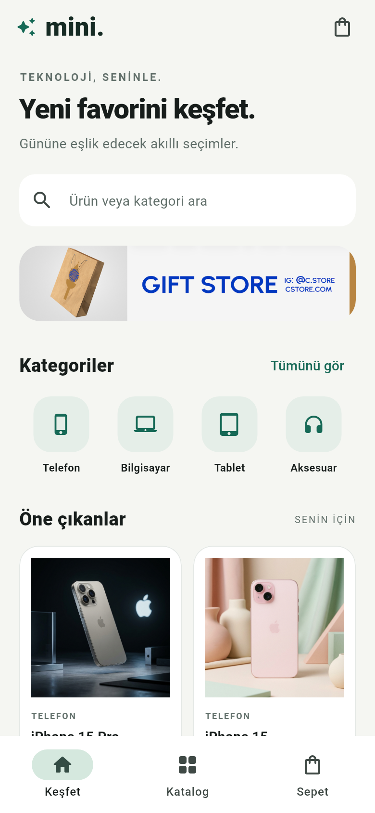
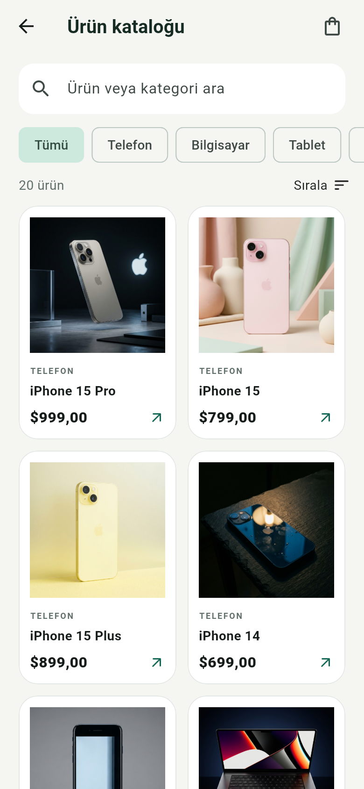
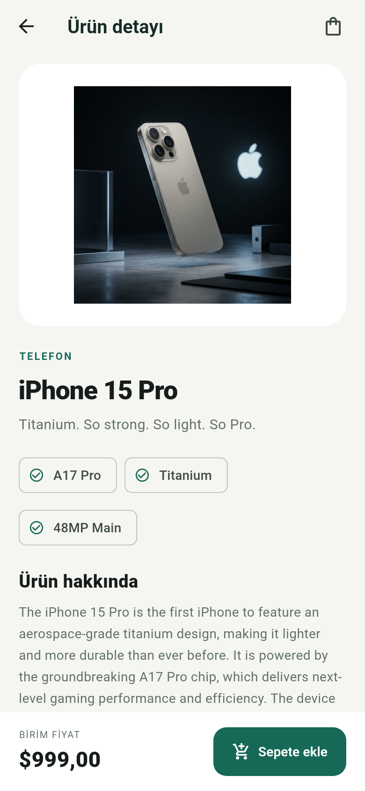
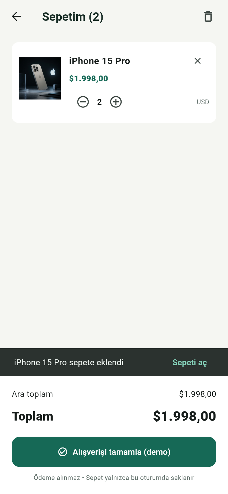

# Mini Katalog Uygulaması

Flutter ile geliştirilen, 20 teknoloji ürününü listeleyen ve basit bir sepet simülasyonu sunan mobil eğitim projesi. Arayüz Türkçedir; ürün adları ve açıklamaları eğitim kaynağından geldiği biçimde korunmuştur.

## Özellikler

- Ana sayfa: banner, kategoriler ve öne çıkan ürünler.
- `GridView.builder` ile ürün kataloğu.
- Ürün adına ve kategoriye göre arama; Türkçe karakter normalizasyonu.
- Kategori filtresi ve fiyat sıralaması.
- Ürün detayı: görsel, açıklama, özellikler ve sepete ekleme.
- Sepette adet artırma/azaltma, ürün çıkarma, temizleme ve toplam hesaplama.
- `Navigator.push/pop`, `MaterialPageRoute` ve named routes.
- `/product` rotasına `Product` nesnesinin `arguments` ile aktarılması.
- `Product.fromJson/toJson`, yerel JSON simülasyonu ve `Image.asset`.
- SDK içindeki `ChangeNotifier` ve `AnimatedBuilder` ile state güncelleme.
- Boş sepet, sonuç bulunamaması ve veri yükleme hatası ekranları.
- Yalnızca Flutter/Dart SDK; ek çalışma zamanı paketi yok.

## Kullanılan sürüm

Bu teslim paketinin doğrulama sürümü `VALIDATION.md` içinde kayıtlıdır.
Flutter **3.47.7 stable** ile hazırlanmıştır. Proje en az Dart 3.8 gerektirir.

## Çalıştırma

1. Flutter SDK, VS Code ve Flutter/Dart eklentilerini kurun.
2. Android Studio üzerinden Android SDK ve bir Android Emulator kurun; emülatörü açın. Alternatif olarak USB hata ayıklaması açık bir Android cihaz bağlayın.
3. ZIP dosyasını çıkarın ve `mini_katalog` klasörünü VS Code ile açın. Terminalin bulunduğu klasörde `pubspec.yaml` olmalıdır.
4. Aşağıdaki komutları sırayla çalıştırın:

```bash
flutter --version
flutter doctor
flutter doctor --android-licenses
flutter pub get
flutter devices
flutter run
```

Birden fazla cihaz görünürse `flutter run -d CIHAZ_KIMLIGI` kullanın. İlk kurulum ve Android derleme araçlarının indirilmesi internet gerektirir. Ürün verileri ve görseller paket içinde bulunduğu için uygulama çalışırken internet gerekmez.

Tarayıcıda hızlı kontrol için:

```bash
flutter run -d chrome
```

Android APK üretmek için (Android SDK kurulmuş olmalıdır):

```bash
flutter build apk --release
```

Çıktı: `build/app/outputs/flutter-apk/app-release.apk`.

## Test ve kontrol

```bash
dart format --output=none --set-exit-if-changed lib test
flutter analyze
flutter test
```

Testler model dönüşümü ve görsellerin varlığını, sepet toplam/adet işlemlerini, Türkçe aramayı ve ana sayfa → katalog → detay → sepet akışını kontrol eder.

Ekran görüntülerini widget testinden yeniden üretmek için PowerShell:

```powershell
$env:RUN_SCREENSHOTS = 'true'
flutter test test/catalog_test.dart
Remove-Item Env:RUN_SCREENSHOTS
```

macOS/Linux:

```bash
RUN_SCREENSHOTS=true flutter test test/catalog_test.dart
```

Görüntüler gerçek Flutter widget ağacından, 390 × 844 mantıksal piksel boyutunda ve 2× çözünürlükte alınır. Android cihaz/emülatör görüntüsü olarak sunulmaz; durum ve Android gezinme çubuklarını içermez.

## Ekran görüntüleri

| Ana sayfa | Ürün kataloğu |
| --- | --- |
|  |  |

| Ürün detayı | Sepet |
| --- | --- |
|  |  |

Boş sepet ve arama görüntüleri de `screenshots/` klasöründedir.

## Klasör yapısı

```text
lib/
  main.dart                       # Tema, ilk yükleme ve rota yönetimi
  data/product_repository.dart    # Asset JSON okuma
  models/product.dart             # Veri modeli
  state/cart_model.dart           # Sepet ve bildirimler
  screens/                        # Ana sayfa, katalog, detay, sepet
  widgets/                        # Tekrar kullanılan ürün kartı ve sepet butonu
  utils/format.dart               # Fiyat biçimi ve arama normalizasyonu
assets/
  data/products.json              # Uygulamanın kullandığı 20 ürün
  data/source_products.json       # Kaynağın değiştirilmemiş yanıtı
  images/                         # Banner ve ürün görselleri
android/                          # Android uygulama yapılandırması
web/                              # Flutter web çalıştırma yapılandırması
test/catalog_test.dart            # Birim ve widget testleri
screenshots/                      # Gerçek Flutter arayüz görüntüleri
```

## Eğitim kaynakları

Yönergede verilen eğitim kaynakları kullanılmıştır:

- Ürünler: https://wantapi.com/products.php
- Banner: https://wantapi.com/assets/banner.png
- Ürün görselleri: kaynak JSON içindeki `https://wantapi.com/assets/images/` adresleri.

Veriler 11 Ekim 2026 tarihinde indirilmiş ve yerel asset olarak paketlenmiştir. Uygulama ağ isteği yapmaz. API'nin `data` dizisi kullanılmıştır; `$2,499` gibi metin fiyatlar sayısal USD değerine dönüştürülmüş, kategori alanı eklenmiş ve görsel adresleri asset yollarına çevrilmiştir. `source_products.json` orijinal yanıtı incelemek için tutulur; uygulama onu okumaz.

Ürün adları ve markaları ilgili hak sahiplerine aittir. Kaynakta belirtilen şekilde içerikler eğitim ve demo amaçlıdır; Apple ile bağlantılı gerçek mağaza değildir. Fiyatlar kaynaktaki **USD** cinsindedir; TL'ye çevrilmemiştir.

## Simülasyon sınırları

Sepet uygulama belleğinde saklanır; uygulama kapanınca sıfırlanır. Gerçek stok, kullanıcı hesabı, veritabanı, sipariş veya ödeme altyapısı yoktur. “Alışverişi tamamla” düğmesi yalnızca demo açıklaması gösterir.

## GitHub teslimi

Public repository: **https://github.com/suelgz/mini-katalog-flutter**

Teslim formuna yukarıdaki repository linkini yazın. Ekran görüntüleri `screenshots/` klasöründe ve bu README içinde bulunur.

Projeyi GitHub'dan indirip çalıştırmak için:

```bash
git clone https://github.com/suelgz/mini-katalog-flutter.git
cd mini-katalog-flutter
flutter pub get
flutter run
```
